<p align="center">
  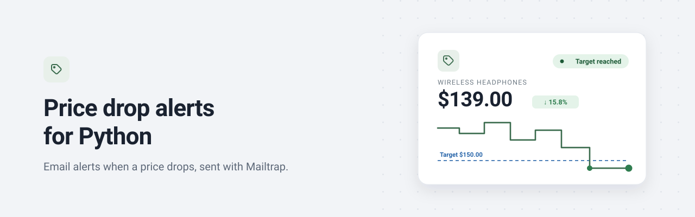
</p>

# Price Drop and Back-in-Stock Email Alerts with Python and GitHub Actions

A free price tracker that runs on GitHub Actions: list the products you care about in a YAML file and get one email when the price drops or the item is back in stock. Written in Python 3.12, it reads schema.org product data, remembers what it already told you, and sends alerts through the Mailtrap Email API. A local dashboard shows every price on a graph. Use it as a Python price tracker, a back-in-stock notifier or a web scraping alert template: no server, no database and no paid service, just a GitHub Actions cron job and transactional email.

<p>
  
  
  
  
  
  
</p>

## The problem

Prices move while you aren't looking, and the good ones disappear fast. Checking by hand wastes time, and most free trackers are browser extensions or services that want an account and your data. Building your own is harder than it looks: it emails you on every run, it chokes on `1.299,00 €`, it treats a sold-out page as an error, a failed email is lost for good, and it needs a server just to run on a schedule.

## What this repo solves

A small, complete Python project that handles each of those details, ready to read, fork and run for free.

| Problem | How this repo handles it |
| --- | --- |
| Missing a price drop | A scheduled GitHub Actions run checks every product and emails you when the price is at or below your target |
| An email on every run | Each alert fires once, when its condition becomes true, and stays quiet until the condition resets |
| Prices written in odd formats | It reads schema.org JSON-LD first, then your CSS selector, and parses `1.299,00 €`, `$1,299.99` and `₹1,29,999` into `Decimal` |
| Items that sell out | A back-in-stock alert fires only on an observed change from out of stock to in stock |
| An alert lost when email fails | An alert is marked as sent only after Mailtrap accepts it, so a failed send is retried on the next run |
| A tracker that silently breaks | After 3 failed checks in a row you get one email with the error, and nothing more until it works again |
| Needing a server or a database | The memory is two small files that the workflow commits back to your repo |
| Not seeing the trend | A local dashboard plots every product's price history, with your target as a line |

**Contents:** [Demo](#demo) · [How it works](#how-it-works) · [Features](#features) · [Stack](#stack) · [Prerequisites](#prerequisites) · [Mailtrap setup](#mailtrap-setup) · [Quick start](#quick-start) · [Screenshots](#screenshots) · [Using the dashboard](#using-the-dashboard) · [Alert rules](#alert-rules) · [Key integration points](#key-integration-points) · [Failure behavior](#failure-behavior) · [Security design](#security-design) · [Configuration](#configuration) · [Run locally](#run-locally) · [Data files](#data-files) · [Project structure](#project-structure) · [Tests](#tests) · [Deploying](#deploying-to-production) · [Scrape responsibly](#scrape-responsibly) · [Limitations](#limitations) · [FAQ](#faq)

## Demo

<p align="center">
  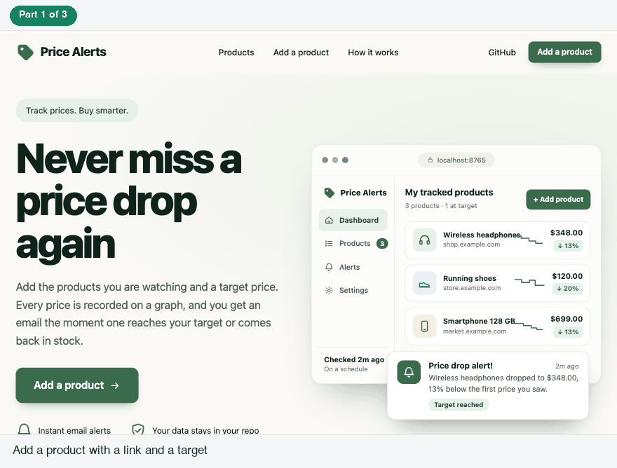
</p>

Adding a product in the local dashboard, watching its price graph, and the alert email that goes out when Check now finds the price below the target. Recorded from a local run of this code with made-up products on `example.com`, a stand-in page fetcher and a mailer that saves the email instead of sending it. The email shown is the app's own template from `src/price_alerts/templates.py`.

## How it works

There is no server and no database. A scheduled GitHub Actions workflow runs a Python script every 6 hours. The script reads your watchlist, checks each product page, emails you through Mailtrap, and commits its memory (two small files in `data/`) back to the repo. The dashboard is an optional page you run on your own machine.

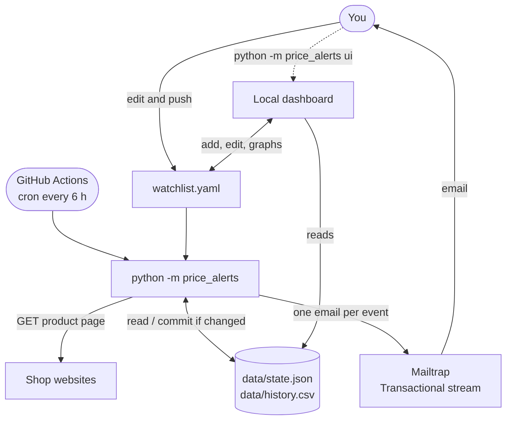

| Part | What it does | Where |
| --- | --- | --- |
| CLI | Arguments, `.env` loading, exit codes, the `ui` subcommand | `src/price_alerts/cli.py` |
| Config | Loads and validates `watchlist.yaml` with pydantic, with clear error messages | `src/price_alerts/config.py`, `models.py` |
| Fetcher | httpx with a clear User-Agent, per-host delay, one retry, robots.txt check | `src/price_alerts/fetch.py` |
| Extractor | schema.org Product JSON-LD first, CSS selector fallback | `src/price_alerts/extract.py` |
| Price parser | `"1.299,00 €"`, `"$1,299.99"`, `"₹1,29,999"` → `Decimal` + currency | `src/price_alerts/parse_price.py` |
| Rules | Pure functions that decide which alerts fire and how state changes | `src/price_alerts/rules.py` |
| State and history | Atomic, byte-stable `state.json` and an append-only `history.csv` | `src/price_alerts/state.py`, `history.py` |
| Templates | Plain-text and inline-styled HTML for every email, all values escaped | `src/price_alerts/templates.py` |
| Mailer | The only code that talks to Mailtrap | `src/price_alerts/mailer.py` |
| Runner | Orchestration with an injectable fetcher, mailer and clock | `src/price_alerts/runner.py` |
| Dashboard | The local web page: products, price graphs, add, edit, Check now | `src/price_alerts/web/` |

### Check to alert

The schedule starts a run. For every product the script reads the price, compares it with what it remembers, and emails you once if a condition just became true.

<p align="center">
  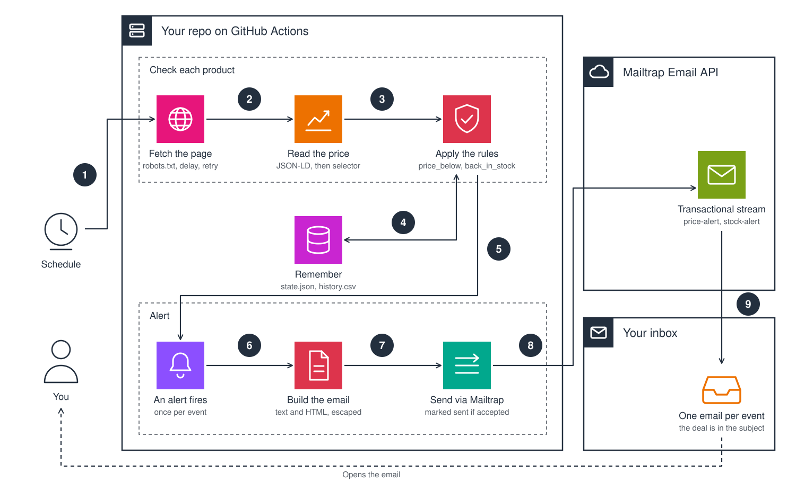
</p>

1. The workflow starts on its cron (`17 */6 * * *`) or when you press **Run workflow**, and runs `python -m price_alerts`.
2. For each product in `watchlist.yaml` it checks `robots.txt` and fetches the page, with a delay between requests to the same host and one retry.
3. It reads the price and stock from the page's schema.org JSON-LD, then from your CSS selector if there is none.
4. The rules compare the result with `data/state.json`. A row is added to `data/history.csv` only when the price or stock changed.
5. When a condition just became true (price at or below the target, back in stock, or 3 failed checks), one alert fires.
6. It builds the plain-text and HTML email, with every value escaped.
7. It sends it through the Mailtrap Transactional stream with a category, and marks the alert as sent only after Mailtrap accepts it.
8. Mailtrap delivers the email.
9. The email arrives in your inbox. Back in the workflow, `data/` is committed only if something changed.

### One run, step by step

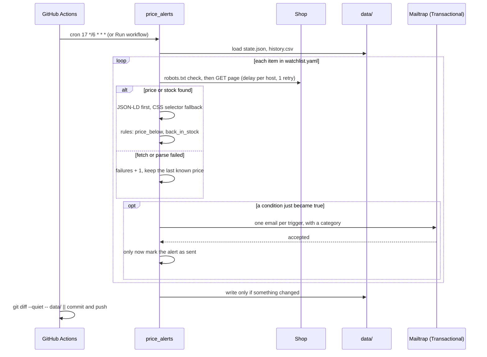

## Features

- **One email per event.** Each alert fires once, when its condition *becomes* true, and stays quiet until the condition resets. Unchanged prices mean no email and no commit.
- **Two alert types.** Get an email when the price is at or below your target price, or when the item is back in stock. Each item can use either or both.
- **Every email shows how good the deal is.** Price and stock emails include the **drop from your target** (for example `0.5% (1.00 EUR below the 200.00 EUR target)`) and the **drop from the last price** (for example `20.1% (249.00 EUR → 199.00 EUR)`).
- **Reads structured data first.** It parses schema.org `Product` JSON-LD, which most shops publish for Google, before falling back to your CSS selector. It handles:
  - `@graph`, top-level lists, and `@type` given as a list
  - `Offer`, offer lists and `AggregateOffer`
  - every way of writing `availability`
- **Understands real-world prices.** It reads `1.299,00 €`, `$1,299.99`, `1 299,00 zł`, `₹1,29,999`, `Rs. 2,499.00`, `EUR 49` and more, using `Decimal` (never float).
- **Failed sends are retried.** If Mailtrap rejects an email, the alert isn't marked as sent and is retried on the next run.
- **Tells you when a watcher breaks.** After 3 failed checks in a row you get one email with the error and a hint, and nothing more until the check works again.
- **Optional daily digest.** At most one email per UTC day with every item's price, 24-hour change, stock and status.
- **Dry run.** Fetch and evaluate everything, save each email as HTML to `out/`, send nothing, and leave `data/` untouched.
- **Polite by default.** It identifies itself in the User-Agent, waits between requests to the same host, and respects `robots.txt`.
- **A local dashboard.**
  - one card per product with its price, change since first seen and a trend line
  - a full price graph per product, with your target as a dashed line and 7, 30, 90 day and all-time ranges
  - add, edit and remove products without touching the YAML by hand, and Check now to run the real checker
  - a made-up demo graph, so you can see the shape of a real one straight away
- **One secret.** The only secret is `MAILTRAP_API_TOKEN`. Everything else lives in `watchlist.yaml`.

## Stack

| | |
| --- | --- |
| Language | Python 3.12, standard library for JSON, CSV, `Decimal`, `urllib.robotparser`, `argparse` and logging |
| HTTP | [httpx](https://www.python-httpx.org/) |
| HTML parsing | [selectolax](https://github.com/rushter/selectolax) (Lexbor backend) |
| Config validation | [pydantic v2](https://docs.pydantic.dev/) |
| Watchlist | YAML via PyYAML |
| Email | [`mailtrap`](https://github.com/railsware/mailtrap-python) Python SDK (the official Mailtrap SDK for Python), Transactional stream |
| Dashboard | Standard library `http.server`, server-rendered HTML and inline SVG charts, with no extra dependency |
| Scheduler | GitHub Actions cron |
| Tests | pytest |

The only runtime dependencies are httpx, selectolax, pydantic, PyYAML and mailtrap. There is no database, no `requests` or BeautifulSoup in the code, and no python-dotenv (a ten-line stdlib loader reads `.env`).

## Prerequisites

- A GitHub account. Actions minutes are free for public repos, and private repos get a monthly allowance. This workflow uses about 4 minutes a day (4 runs, each under a minute).
- A [Mailtrap](https://mailtrap.io) account. The free plan is enough.
- Python 3.12, only if you want to run it on your own computer or use the dashboard.

## Mailtrap setup

1. **Create an API token.** In Mailtrap, go to Settings, API Tokens, and create a token with access to your sending domain.
2. **First run on the demo domain.** New accounts get a demo sending domain, `demomailtrap.co`. Set `from_email: alerts@demomailtrap.co` and put your Mailtrap account email in `default_recipients`. The demo domain delivers only to the account owner, which is exactly what a personal price tracker needs. Mail from a shared demo domain often lands in spam, so check there for the first email.
3. **Verify your own domain to email anyone.** Add your domain under Sending Domains and create the DNS records Mailtrap shows (SPF, DKIM and DMARC). Then set `from_email` to an address on it. If the sender isn't on one of your domains, Mailtrap answers `Unauthorized` even when the token is valid.
4. **Know the free plan limits.** The free plan allows 4,000 emails a month and 150 a day. A price tracker sends a handful a week. See [Mailtrap sending limits](https://docs.mailtrap.io/email-api-smtp/setup/sending-limits).

## Quick start

1. **Create your copy.** Click **Use this template** (or **Fork**) at the top of this repo.
2. **Add the secret.** In your repo, go to **Settings → Secrets and variables → Actions → New repository secret**. Set the name to `MAILTRAP_API_TOKEN` and the value to your token.
3. **Edit `watchlist.yaml`.** Set `from_email` (see [Mailtrap setup](#mailtrap-setup)), set `default_recipients` to your inbox, and replace the example item with your products. Commit the change.
4. **Run the workflow.** Open the **Actions** tab and enable workflows if GitHub asks. Then choose **Price alerts → Run workflow**.
5. **Get your first alert.** The first run records baselines (the current price and stock), so it usually sends nothing. To test right away, set an item's `target_price` *above* its current price with `notify_on: [price_below]`, and run the workflow again.

From then on, the workflow runs every 6 hours (`17 */6 * * *`, off the hour because runs at `:00` are often delayed) and commits price changes to `data/` as `github-actions[bot]`.

To see your products on a graph, run the dashboard on your own machine:

```bash
git clone https://github.com/manishgupta412/python-price-drop-alerts.git && cd python-price-drop-alerts
python3.12 -m venv .venv && source .venv/bin/activate
pip install -r requirements-dev.txt
python -m price_alerts ui --open
```

### What you'll see in the terminal

**Try it without sending anything.** A dry run fetches the page, works out the alert and saves the email to `out/`, but sends nothing and leaves `data/` untouched.

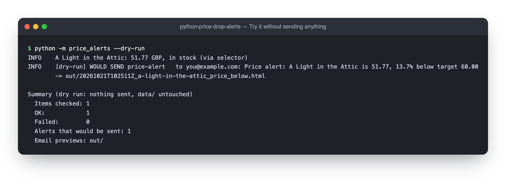

**Open the dashboard.** One line tells you where it is listening, and each page request is logged.

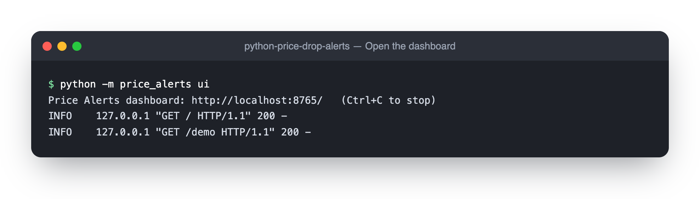

**Run the tests.** They need no credentials and no network.

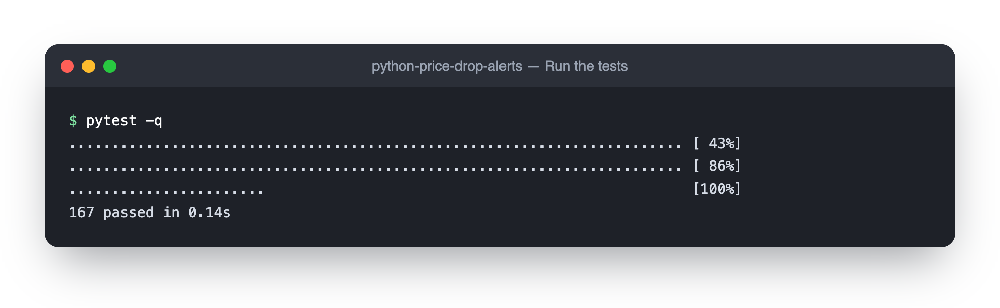

## Screenshots

<p align="center">
  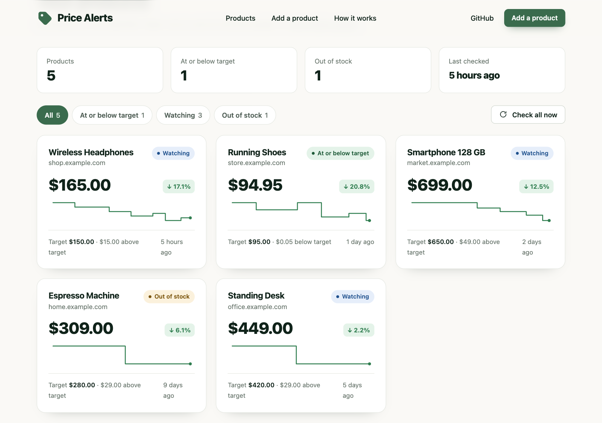
  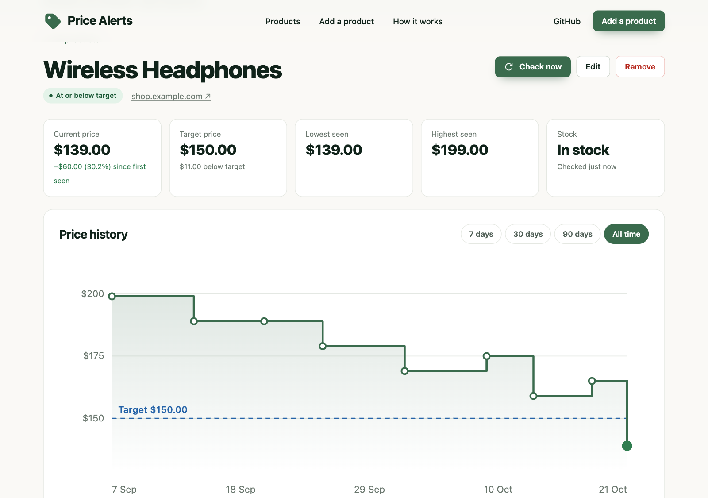
</p>
<p align="center">Every product on one page, and the full price graph for one of them with your target as a dashed line.</p>

<p align="center">
  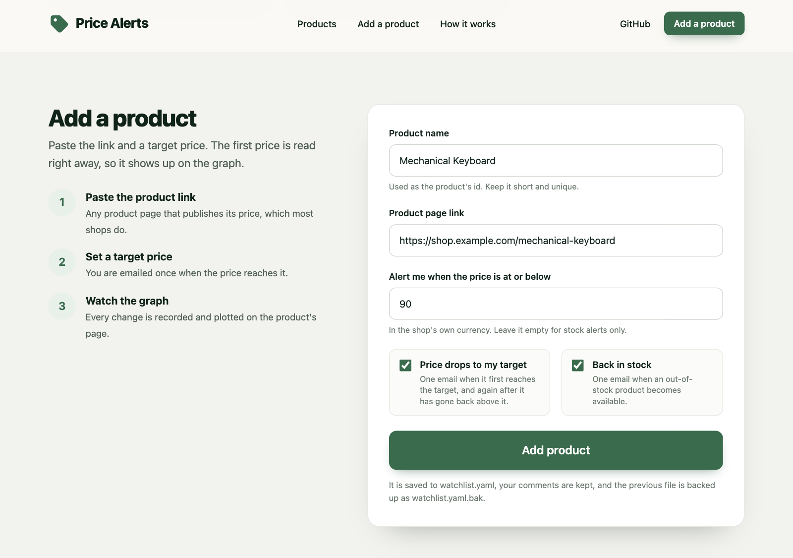
  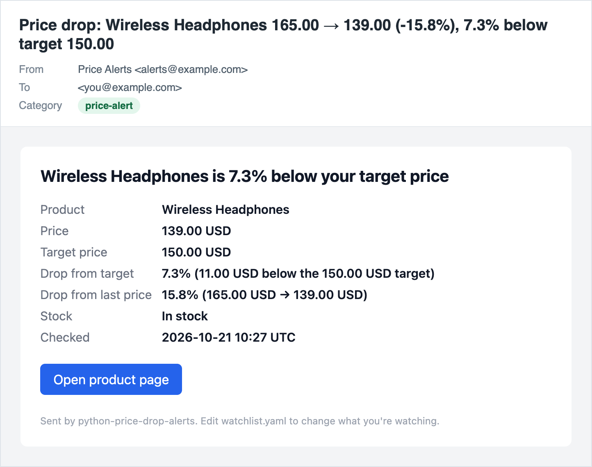
</p>
<p align="center">Add a product with a link and a target, and get one email when the price reaches it.</p>

The screenshots show a local run of the dashboard with made-up products on `example.com`, a stand-in page fetcher and a mailer that saves the email instead of sending it. The email is the app's own template, and every email also has a plain-text version.

## Using the dashboard

A small web page for your own machine. It reads and writes the same files as the command line (`watchlist.yaml`, `data/state.json` and `data/history.csv`), so the scheduled GitHub Actions run and the dashboard always agree.

```bash
python -m price_alerts ui              # http://localhost:8765
python -m price_alerts ui --open       # also opens your browser
```

```text
python -m price_alerts ui [--watchlist watchlist.yaml] [--data-dir data] [--host 127.0.0.1] [--port 8765] [--open]
```

**What you can do**

- **Your products.** One card per product with the current price, the change since it was first seen, a small trend line, how far it is from your target, and when it was last checked. Filter by *At or below target*, *Watching*, *Out of stock* or *Needs attention*.
- **A price graph for every product.** Open a product to see the full history as a step chart: the price holds until the next recorded change and runs on to now. Your target is a dashed line, points at or below it are solid green, and hovering a point shows the exact price and time. Switch between 7 days, 30 days, 90 days and all time. Below it are the lowest and highest prices seen and a table of every recorded change.
- **A demo graph.** Open `/demo` (linked from the dashboard and from products that have only a few prices) to see a sample product whose price rises and falls around its target. It is made-up data that is never saved or sent, so you can see what a real graph looks like before real history builds up.
- **Add a product.** Paste the link and a target price. The product is saved to `watchlist.yaml` and checked straight away, so its first price appears on the graph. For a page without schema.org price data, add a `selector` in `watchlist.yaml`.
- **Check now.** Run the real checker for one product or all of them. If a price is at your target, the alert email goes out through Mailtrap exactly as it does on GitHub Actions. Without a `MAILTRAP_API_TOKEN`, prices are still recorded and any alert is held back, so the next run with the token sends it.
- **Edit or remove.** Change the page link, the target or the alert types. Selectors and recipients that are set in `watchlist.yaml` are kept as they are, and the name is the product's id, so it is fixed. Removing a product keeps its recorded history in `data/history.csv`. The last product can't be removed, because a watchlist needs at least one.

**How it edits `watchlist.yaml`**

Changes are made to the text of the file, so your comments and the other products stay exactly as they were. Before replacing the file the dashboard checks the result with the same loader the checker uses, so a change that would break the watchlist is refused with a message. The previous version is kept as `watchlist.yaml.bak` (git-ignored).

## Alert rules

Every rule fires **once when its condition becomes true** and stays quiet until it resets. The rules are pure functions in [`src/price_alerts/rules.py`](src/price_alerts/rules.py).

| Rule | Fires when | Resets when |
| --- | --- | --- |
| `price_below` | price ≤ `target_price`. This can fire on the first check. | price goes back above `target_price` |
| `back_in_stock` | stock changes from out of stock to in stock. Not on the first check, and not from "unknown". | the item goes out of stock again |
| watcher error | 3 failed checks in a row | the next successful check |

There is no separate percentage setting: an email is only sent when the price is at or below `target_price`. Instead, every price and stock email reports two numbers:

| In the email | Compared with | Example |
| --- | --- | --- |
| **Drop from target** | your `target_price` | `0.5% (1.00 EUR below the 200.00 EUR target)` |
| **Drop from last price** | the price at the previous check | `20.1% (249.00 EUR → 199.00 EUR)` |

If there is no drop, the email says so: `none: 5% above the 200.00 EUR target`, `0% (unchanged at 199.00 EUR)`, `none: up 5% (190.00 EUR → 199.50 EUR)`, or `n/a (first check)`.

Example with `target_price: 200`:

| Run | Price | Stock | Emails |
| --- | --- | --- | --- |
| 1 | 249.00 | in stock | none: price recorded, above target |
| 2 | 249.00 | in stock | none: nothing changed, no commit either |
| 3 | 199.00 | in stock | **Price drop**: 0.5% below target, 20.1% below last price |
| 4 | 189.00 | in stock | none: still below target, you were already told |
| 5 | 189.00 | out of stock | none |
| 6 | 189.00 | in stock | **Back in stock**: 5.5% below target, 0% from last price |
| 7 | 210.00 | in stock | none: above target, so `price_below` re-arms |
| 8 | 195.00 | in stock | **Price drop**: 2.5% below target, 7.1% below last price |

Every email has a Mailtrap category, so the types are easy to tell apart in Mailtrap stats:

| Email | Stream | Category | Subject |
| --- | --- | --- | --- |
| At or below target | Transactional | `price-alert` | `Price drop: Example Headphones 249.00 → 199.00 (-20.1%), 0.5% below target 200.00` |
| Back in stock | Transactional | `stock-alert` | `Back in stock: Example Headphones` |
| 3 failed checks in a row | Transactional | `watcher-error` | `Watcher error: Example Headphones failed 3 checks in a row` |
| Daily digest | Transactional | `digest` | `Price digest 2026-10-14: 3 items` |

## Key integration points

**One email, one stream.** The client is created without `bulk` or `sandbox`, so the SDK sends to the Transactional stream. Every email carries a category ([`src/price_alerts/mailer.py`](src/price_alerts/mailer.py)):

```python
import mailtrap as mt

client = mt.MailtrapClient(token=token)

client.send(mt.Mail(
    sender=mt.Address(email=from_email, name=from_name),
    to=[mt.Address(email=address) for address in message.to],
    subject=message.subject,
    text=message.text,
    html=message.html,
    category=message.category,   # price-alert, stock-alert, watcher-error, digest
))
```

**Mark an alert as sent only after Mailtrap accepts it.** The rules return each alert together with the state change that marks it sent (`on_sent`). The runner applies that change only when the send succeeds, so a failed send is retried on the next run instead of being lost ([`src/price_alerts/runner.py`](src/price_alerts/runner.py)):

```python
evaluation = evaluate(item, prev, result)
new_state = evaluation.state
for alert in evaluation.alerts:
    message = build_alert_email(item, alert, watchlist.recipients_for(item), now)
    if deliver(message):
        new_state = apply_sent(new_state, alert)   # e.g. {"price_below_active": True}
```

**Unchanged prices produce no diff.** `last_checked` is only bumped when something about the item actually changed, `state.json` is written with sorted keys and only if its content differs, and `history.csv` gets a row only when the price or stock changed:

```python
if new_state != prev:
    new_state = new_state.updated(last_checked=now_iso)
```

That is what makes the workflow's commit step a no-op on quiet runs:

```bash
if git diff --quiet -- data/; then
  echo "No price or state changes."
  exit 0
fi
git add data/
git commit -m "chore: update price data [skip ci]"
```

**Structured data before selectors.** The extractor walks every `<script type="application/ld+json">` block, skips invalid JSON, finds the `Product` (top level, in a list, or in `@graph`), and picks the lowest in-stock offer. Your CSS `selector` is used only when that yields no price ([`src/price_alerts/extract.py`](src/price_alerts/extract.py)).

**Edit the YAML as text.** The dashboard adds, replaces and removes one product block at a time, and validates the whole file with the real loader before it replaces the old one, so comments survive and an invalid change never reaches disk ([`src/price_alerts/web/editor.py`](src/price_alerts/web/editor.py)):

```python
def write_validated(path: Path, new_text: str) -> None:
    # write to a temp file, run load_watchlist() on it, keep a .bak, then os.replace()
```

## Failure behavior

| Situation | What happens |
| --- | --- |
| Product page returns 4xx, times out, or has no price | The check counts as failed. The last known price and stock are kept, and `consecutive_failures` goes up by one. |
| 5xx or network error | One retry, then the same as above. |
| 3 failures in a row | One `watcher-error` email with the URL, the last error and a hint to check the URL or selector. No more until the check works again. |
| Check works again after failures | The counter and the warning reset silently. |
| `robots.txt` disallows the page | A failure with the reason "Blocked by robots.txt". |
| Mailtrap rejects or fails an email | The error is logged without the token, the alert is not marked as sent, other items continue, and the run exits with code `2`. The next run retries. |
| Mailtrap answers `Unauthorized` | Usually the sender isn't on a verified domain, or the token is wrong. |
| `MAILTRAP_API_TOKEN` missing | The run exits with code `1` before fetching anything. Use `--dry-run` to run without it. |
| Invalid `watchlist.yaml` | The run exits with code `1`, and each error names the item and the field. For example: `item 'Example Headphones': target_price: required when notify_on includes price_below`. |
| One item throws an unexpected error | It's recorded as a failure for that item, and the other items still run. |
| Page has stock info but no price (common on sold-out pages) | The check counts as a success, and stock alerts still work. |
| Workflow runs while another is running | The `concurrency` group queues it, so runs never overlap. |
| Dashboard: a form value is invalid | The page lists what to fix, keeps what you typed and writes nothing. |
| Dashboard: Check now without a token | Prices are recorded and the alert is held back, so the next run with the token sends it. |
| Dashboard: removing the last product | Refused, because a watchlist needs at least one. |

## Security design

| Threat | Mitigation |
| --- | --- |
| The Mailtrap token leaking | It is the only secret. It lives in a GitHub repository secret or a git-ignored `.env`, is never printed or logged, and the `.env` loader never overrides a real environment variable. |
| Untrusted page content ending up in an email | Every value is HTML-escaped in the templates, and tests check it |
| Unsafe configuration | `yaml.safe_load`, strict pydantic models that reject unknown fields, and `http(s)` URLs only |
| Hammering a website | `robots.txt` is respected, requests to one host are spaced out, there is one retry, and the User-Agent says who is asking |
| Duplicate or lost alerts | An alert is marked as sent only after Mailtrap accepts it, and each condition fires once until it resets |
| Another website reaching the dashboard through your browser | It listens on `127.0.0.1` only and refuses any other `Host` header |
| Forged form posts | Every dashboard form carries a CSRF token |
| Cross-site scripting | All dashboard output is escaped, and a strict Content Security Policy only allows the page's own script |
| A broken edit corrupting the watchlist | Changes are validated with the real loader before the file is replaced, and the old version is kept as `watchlist.yaml.bak` |
| Exposing recipients | The dashboard shows how many recipients a product has, never their addresses |

**Trade-offs to know about:**

- **The dashboard has no login.** It is meant for your own machine. With `--host 0.0.0.0`, anyone who can reach that address can edit your watchlist and trigger emails.
- **The workflow can write to your repo.** It needs `contents: write` to commit `data/`. If your default branch is protected, allow the bot to push or change the commit step.
- **You are scraping other people's pages.** Keep the frequency low and follow each site's rules, see [Scrape responsibly](#scrape-responsibly).
- **The demo domain only reaches you.** `demomailtrap.co` delivers only to the Mailtrap account owner, so use your own verified domain to email anyone else.

## Configuration

### `watchlist.yaml`

```yaml
settings:
  from_email: alerts@yourdomain.com   # must be on a Mailtrap-verified sending domain
  from_name: Price Alerts
  default_recipients: [you@example.com]
  request_delay_seconds: 5            # delay between requests to the same host
  timeout_seconds: 20
  respect_robots_txt: true
  digest: false                       # DIGEST env var overrides
items:
  - name: Example Headphones
    url: https://example.com/product/123
    selector: ".price"                # optional CSS fallback for price
    stock_selector: ".availability"   # optional
    out_of_stock_text: ["out of stock", "sold out"]  # optional
    target_price: 199.99              # email when the price is at or below this
    notify_on: [price_below, back_in_stock]
    recipients: [you@example.com]     # optional, falls back to default_recipients
```

| Field | Purpose |
| --- | --- |
| `from_email`, `from_name` | Sender. The address must be on a domain verified in Mailtrap. |
| `default_recipients` | Where alerts and the digest go. Required unless every item has `recipients`. |
| `request_delay_seconds` | Minimum gap between requests to the same host. Default `5`. |
| `timeout_seconds` | HTTP timeout per request. Default `20`. |
| `respect_robots_txt` | Skip pages that `robots.txt` disallows. Default `true`. |
| `digest` | Daily summary email. Default `false`. |
| `name` | Unique. Its slug (`example-headphones`) is the item's key in `state.json`, so if you rename an item, its history starts over. |
| `url` | An `http(s)` product page. |
| `selector`, `stock_selector`, `out_of_stock_text` | CSS fallback for the price and stock text. The text matching ignores case. |
| `target_price` | Required for `price_below`. |
| `notify_on` | `price_below`, `back_in_stock`, or both. Default: both if `target_price` is set, otherwise `back_in_stock`. |
| `recipients` | Overrides `default_recipients` for this item. |

### Environment

| Variable | Purpose |
| --- | --- |
| `MAILTRAP_API_TOKEN` | Mailtrap API token. The only secret: a repository secret on GitHub, or `.env` locally. |
| `DIGEST` | `true` or `false`. Overrides `settings.digest`. On GitHub, set it as a repository **variable** (not a secret). |
| `DRY_RUN` | `true` is the same as `--dry-run`. The workflow sets it from the **dry_run** checkbox. |

### Finding a CSS selector

You only need one when the page has no schema.org price. Run `python -m price_alerts --dry-run --only "Item name" -v`: the log says `via json-ld` or `via selector`.

1. Right-click the price on the product page and choose **Inspect**.
2. Pick a stable class or attribute, such as `.product-price .amount` or `[itemprop="price"]`. Avoid generated classes like `.css-1x2y3z`.
3. Test it in the browser console: `document.querySelector(".product-price .amount").textContent`.
4. Put it in `selector`. If the element has a `content` attribute (`<meta itemprop="price" content="12.99">`), that value is used.

## Run locally

```bash
git clone https://github.com/manishgupta412/python-price-drop-alerts.git && cd python-price-drop-alerts
python3.12 -m venv .venv && source .venv/bin/activate
pip install -r requirements-dev.txt         # runtime deps + pytest, installs the package
cp .env.example .env                        # paste your MAILTRAP_API_TOKEN
python -m price_alerts --dry-run -v
python -m price_alerts
```

```text
python -m price_alerts [--watchlist watchlist.yaml] [--data-dir data] [--dry-run] [--only NAME] [-v]
```

- **`--dry-run`** fetches and evaluates everything and saves each email as `out/<timestamp>_<item>_<kind>.html`. It sends nothing and doesn't modify `data/`. On GitHub, tick **dry_run** in **Run workflow**; the previews are uploaded as the `email-previews` artifact.
- **`--only NAME`** checks one item, by name or id.
- **Exit codes:** `0` OK (failed product checks don't change it), `1` config error, `2` at least one email failed to send.
- **`.env`** is read only if it exists, never overrides real environment variables, and its values are never printed. It's git-ignored.

## Data files

Both files are committed by the workflow as `github-actions[bot]` with `chore: update price data [skip ci]`, and only when something changed.

- **`data/state.json`.** Per item: `last_price`, `last_currency`, `last_in_stock`, `consecutive_failures`, `error_alert_sent`, `last_error`, `price_below_active` and `last_checked` (the last check that changed something), plus a top-level `last_digest_date`. It's written atomically (temp file + replace) with sorted keys.
- **`data/history.csv`.** `timestamp,item_id,name,price,currency,in_stock,source`, with one row each time the price or stock changed. The dashboard plots it, and you can open it in a spreadsheet too.

To start over, set `state.json` to `{}` and keep only the header line of `history.csv`.

## Project structure

```text
.
├── .github/workflows/
│   ├── price-alerts.yml      cron every 6 h + manual run with dry_run, commits data/
│   └── tests.yml             pytest on push and pull request
├── data/                     state.json and history.csv (committed by the bot)
├── docs/                     banner, demo GIF, screenshots, terminal logs, flow diagram
├── src/price_alerts/
│   ├── __main__.py  cli.py   python -m price_alerts, arguments, exit codes
│   ├── config.py             watchlist loading, .env loader, readable validation errors
│   ├── models.py             pydantic Settings/Item/Watchlist, FetchResult, EmailMessage
│   ├── fetch.py              httpx fetcher: User-Agent, per-host delay, retry, robots.txt
│   ├── extract.py            JSON-LD Product parsing, CSS selector fallback
│   ├── parse_price.py        price text → Decimal + currency
│   ├── rules.py              price_below, back_in_stock, failures (pure)
│   ├── state.py  history.py  state.json and history.csv
│   ├── templates.py          subject, plain text and HTML for every email
│   ├── mailer.py             Mailer protocol, MailtrapMailer
│   ├── runner.py             orchestration with injectable fetcher, mailer and clock
│   └── web/                  the local dashboard (python -m price_alerts ui)
│       ├── app.py            routes, forms, CSRF and Host checks, Check now
│       ├── server.py         standard-library HTTP server around app.py
│       ├── views.py          the pages (HTML)
│       ├── charts.py         SVG sparklines and the price graph
│       ├── model.py          per-product view models: status, change, low and high
│       ├── editor.py         add, replace and remove a product in watchlist.yaml as text
│       ├── demo.py           the made-up product behind /demo
│       ├── assets.py         stylesheet, icons and the hero mockup
│       └── format.py         money, dates and "2 days ago"
├── tests/                    pytest suites + fixtures/ (saved product pages)
├── watchlist.yaml            what to watch and who to email
├── requirements.txt          pinned runtime deps
└── requirements-dev.txt      + pytest
```

`runner.run()` takes the fetcher, mailer and clock as arguments. That is what lets the tests run against saved HTML pages, a fake mailer and a fixed clock, with no network and no Mailtrap account.

## Tests

```bash
pip install -r requirements-dev.txt
pytest
```

The suite has 167 tests and needs no credentials or network. It covers:

- **Extraction:** every JSON-LD variant (simple, `@graph`, top-level list, offer list, `AggregateOffer`, out of stock) and the mapping of every availability value.
- **Fallbacks:** the CSS selector when JSON-LD is missing or broken, and a page with nothing parseable.
- **Price parsing:** a table of real-world formats, with garbage returning `None`.
- **Alert rules:** `price_below` fires once and re-arms, and `back_in_stock` fires only on a change from out of stock to in stock.
- **Email content:** the drop from the target and from the last price, including the at-target, above-target, first-check and price-went-up cases.
- **Acceptance:** two runs with unchanged prices send **zero** emails and leave `state.json` and `history.csv` byte-identical.
- **Failures:** 1 and 2 failures send nothing, the 3rd sends exactly one watcher error, the 4th sends none, and a success resets.
- **Email categories:** every email has the correct category, and values are HTML-escaped.
- **Dry run:** nothing is sent, `out/*.html` is written, and `data/` is untouched.
- **Send failures:** the alert isn't marked, and it's retried on the next run.
- **Config and fetcher:** validation messages, the `.env` loader, and the fetcher's retry, robots.txt and User-Agent (via `httpx.MockTransport`).
- **Dashboard:** the pages, adding, editing and removing products (comments kept, invalid input explained, nothing written on error), Check now with and without a token, CSRF and Host checks, security headers and escaping.
- **Demo:** the sample graph, that it is read-only and writes nothing, and that the dashboard links to it.
- **Graphs:** one marker per price, the target line, time ranges, the empty state and escaped text.

## Deploying to production

"Production" here is a GitHub repository that runs the workflow for you.

- **Use your own copy.** Click **Use this template** or **Fork**. Actions minutes are free for public repos, and private repos get a monthly allowance.
- **Set the secret.** Add `MAILTRAP_API_TOKEN` under **Settings → Secrets and variables → Actions**. For the daily digest, add a repository **variable** named `DIGEST` with the value `true`.
- **Use your own sender.** Verify your sending domain in Mailtrap and set `from_email` on it, see [Mailtrap setup](#mailtrap-setup).
- **Let the bot commit.** The workflow has `contents: write` so it can commit `data/`. If your default branch is protected, allow `github-actions[bot]` to push, or change the commit step.
- **Change the schedule.** Edit the `cron` line in [`.github/workflows/price-alerts.yml`](.github/workflows/price-alerts.yml). Every 6 hours is plenty for prices.
- **Enable Actions.** Scheduled workflows don't run in a new fork until you enable Actions, and GitHub disables them in a public repo after 60 days with no activity.
- **Rename the User-Agent.** If you fork, change it in `src/price_alerts/fetch.py` to point at your repo.
- **Keep the dashboard local.** It has no login, so don't put it on a public address.

## Scrape responsibly

- **Check `robots.txt` and the site's terms of service.** `respect_robots_txt: true` (the default) skips disallowed pages. Turn it off only for sites you have permission to check.
- **Keep the frequency low.** Every 6 hours is plenty for prices, and `request_delay_seconds` spaces out requests to the same host.
- **Identify yourself.** Requests send `User-Agent: python-price-drop-alerts/1.0 (+https://github.com/manishgupta412/python-price-drop-alerts)`. If you fork, change it in `src/price_alerts/fetch.py` to your repo.
- **Don't scrape behind logins**, and don't try to get around blocks or CAPTCHAs.

## Limitations

- **JavaScript-rendered prices.** No browser runs here. If the price only appears after JavaScript runs and isn't in the JSON-LD, the tool can't see it. Many such shops still include JSON-LD in the HTML.
- **Sites that block bots.** Some shops return 403 or a CAPTCHA to non-browser clients or to cloud IP ranges, including GitHub's runners. You'll get one watcher-error email. Respect the block.
- **Scheduled workflows get disabled.** GitHub doesn't run scheduled workflows in forks until you enable Actions, and disables them in public repos with no activity for 60 days. Bot commits only happen when prices change. If the emails stop, check the Actions tab and re-enable the workflow.
- **Cron timing is approximate.** GitHub may delay scheduled runs at busy times.
- **The dashboard is local and has no login.** It is for your own machine, and graphs only show prices recorded in `data/history.csv`.
- **New products need schema.org data.** Products added in the dashboard can't take a CSS selector. For a page without price data, add a `selector` in `watchlist.yaml`.

## FAQ

### How do I get an email when a product's price drops?

Add the product to `watchlist.yaml` with a `target_price`, and add your `MAILTRAP_API_TOKEN` as a repository secret. The scheduled workflow checks every 6 hours and reads the price from the page's schema.org data or your CSS selector.

It emails you once through Mailtrap when the price is at or below your target, and the email says how far below the target it is. See [Quick start](#quick-start).

### How do I run a Python script on a schedule for free?

Use GitHub Actions with an `on: schedule` cron trigger, as [`.github/workflows/price-alerts.yml`](.github/workflows/price-alerts.yml) does with `cron: "17 */6 * * *"`. Public repos get free Actions minutes, and private repos get a monthly allowance. Pick an off-the-hour minute, because runs at `:00` are often delayed.

If the script needs memory between runs, commit a small state file back to the repo, as this project does with `data/`, so you need no database or server.

### How do I avoid sending the same alert twice?

Store whether each condition already fired, and alert only when it changes from false to true. Here, `price_below_active`, `last_in_stock` and `error_alert_sent` in `data/state.json` record that, and each resets only when its condition does.

Set the flag only after the email is accepted, so a failed send is retried instead of lost. See [Alert rules](#alert-rules).

### How do I chart a product's price history?

Record a row only when the price or stock changes, as `data/history.csv` does, and plot those rows as a step chart, because a price holds until the next change. The dashboard does this with inline SVG and no chart library.

Run `python -m price_alerts ui` and open a product, or open `/demo` for a sample graph. See [Using the dashboard](#using-the-dashboard).

### How do I send email from a Python script?

Use a transactional email API rather than SMTP from a runner. With the official Mailtrap SDK (`pip install mailtrap`), create a client with your API token and send an `mt.Mail` with a sender on your verified domain, recipients, a subject, text and HTML, and a category for stats.

The full code is under [Key integration points](#key-integration-points), and [`src/price_alerts/mailer.py`](src/price_alerts/mailer.py) wraps it behind a small `Mailer` interface so tests can use a fake.

### How do I build a price tracker in Python?

Fetch the product page with `httpx`, read the price from its schema.org `Product` JSON-LD (with a CSS selector as a fallback), parse it into a `Decimal`, compare it with your target price, and send an email through a transactional email API when it drops. Store the last price and which alerts were sent, so each alert fires once. This repo is a complete version of that.

### How do I get a back-in-stock email alert?

Read the product's `availability` from its schema.org data on every check, remember the last value, and email only when it changes from out of stock to in stock. Add `back_in_stock` to an item's `notify_on` list. See [Alert rules](#alert-rules).

### How do I scrape a product price from JSON-LD or a CSS selector?

Most shops publish schema.org JSON-LD for Google, which is more stable than page markup. Parse the `Offer` or `AggregateOffer` price and `availability` first, and fall back to a CSS selector when the page has none. This repo handles `@graph`, offer lists and many price formats such as `1.299,00 €` and `₹1,29,999`. See [Finding a CSS selector](#finding-a-css-selector).

### How do I test a price alert without sending an email?

Run a dry run. It fetches and evaluates everything, saves each email as HTML in `out/`, sends nothing and leaves `data/` untouched. The test suite also runs without credentials or network, using `httpx.MockTransport` and a fake mailer.

## License

[MIT](LICENSE)
